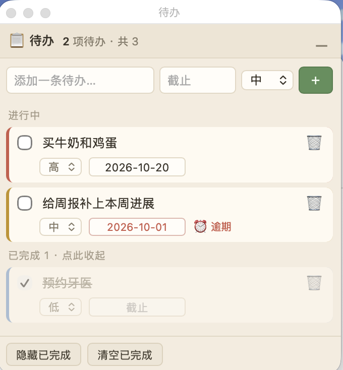

# agent-todo

**A todo list that lives inside your agent — and floats on your desktop.**
**一份住在 agent 里、也浮在桌面上的待办清单。**

`agent-todo` keeps your personal todos in one plain-text JSON file that both you
and your AI agent can read and write. Say *"记一条待办：周五交周报"* and it's
saved. Say *"把「买牛奶」标完成"* and it's ticked. No sign-up, no cloud, no
database — just `~/.agent-todo/todos.json`.

On macOS you also get an optional **always-on-top floating widget** that shows
the same file: click the header to expand, click again to collapse, `⌥⌘X` to
summon it from anywhere. Edit on the widget or ask the agent — both sides write
the same file, so they stay in sync within a second.

<p align="center"></p>

---

## 为什么用这个 / Why this

- **纯文本、你自己拥有。** 一个 JSON 文件，随时能 `cat`、能 git、能手改；不锁在某个 App 里。
  *Plain text you own.* One JSON file you can read, edit, back up or git — not trapped inside an app.
- **说话就行，不用切界面。** 「记一条待办」「把 X 标完成」「我今天还有哪些没做」。
  *Just say it.* Add, tick, delete, review — in natural language.
- **可以很好看。** 可选的原生 macOS 置顶浮窗，点开是列表，收起是一条细条。
  *Optional eye-candy.* A native always-on-top macOS widget that collapses to a thin bar.
- **零依赖。** Skill 侧只有一个 Python 脚本（标准库）；浮窗是一个约 350 行的 Swift 文件。
  *Zero dependencies.* A single standard-library Python script, and a ~350-line Swift file.

## 特性 / Features

| | |
|---|---|
| 🗒️ 增删改勾选 | add / edit / tick / delete, with priority 高·中·低, due date and tags |
| ⏰ 逾期提醒 | a due date in the past turns red and marks **⏰逾期** automatically |
| 🔽 展开 / 收拢 | the widget collapses to a thin bar showing your unfinished count |
| ⌥⌘X 全局快捷键 | show / hide the widget from any app (no Accessibility permission needed) |
| 🔗 双向同步 | the agent and the widget share one file — edit either, see it in both |
| 📄 一份数据 | `~/.agent-todo/todos.json`, plain and portable |

## 安装 / Install

### 1. Skill（任何支持 `SKILL.md` 的 agent）

```bash
git clone https://github.com/Lessie-wang/agent-todo.git
cd agent-todo
./install.sh                       # 装到 ~/.claude/skills/agent-todo
# 换个位置：SKILLS_DIR=~/path/to/skills ./install.sh
```

装完直接说 **「记一条待办：周五交周报」** 就能用。

### 2. 桌面浮窗（macOS 13+，可选）

```bash
cd app && ./build.sh && open "Agent Todo.app"
```

想开机自启就改用一键安装（会顺带编译浮窗并注册登录项）：

```bash
./install.sh --with-app
```

## 用法 / Usage

**对 agent 说（自然语言）**

> 记一条待办：周五交周报
> 我今天还有哪些没做？
> 把「买牛奶」标完成
> 删掉「预约牙医」

**命令行**（不用 agent 也能用）

```bash
cd ~/.claude/skills/agent-todo/scripts
python3 todo.py add "周五交周报" --priority high --due 2026-10-20 --tags 工作
python3 todo.py list
python3 todo.py done t3
python3 todo.py rm t3
python3 todo.py clear-done
```

**浮窗**

- 点顶栏那条 **📋 待办** → 展开 / 收起
- **⌥⌘X** → 从任何地方唤出或隐藏
- 展开后：勾选完成、改文字、设优先级/截止日期、删除、隐藏已完成、清空已完成
- 关窗只是隐藏（进程还在）；退出走菜单栏 **☑︎** 图标 →「退出」

## 数据格式 / Data

`~/.agent-todo/todos.json`（用 `AGENT_TODO_HOME` 换目录）：

```json
{
  "collapsed": false,
  "seq": 3,
  "todos": [
    { "id": "t1", "text": "买牛奶和鸡蛋", "done": false,
      "priority": "high", "due": "2026-10-20", "tags": "生活" }
  ]
}
```

`priority` 取 `high | mid | low`，`due` 是 `YYYY-MM-DD` 或空。这个文件就是唯一真源，agent 和浮窗都只改它。

## 卸载 / Uninstall

```bash
rm -rf ~/.claude/skills/agent-todo
# 浮窗 + 自启：
launchctl bootout gui/$(id -u)/dev.agenttodo.float 2>/dev/null
rm -f ~/Library/LaunchAgents/dev.agenttodo.float.plist
rm -rf "$(pwd)/app/Agent Todo.app"
# 你的数据不动，仍留在 ~/.agent-todo/todos.json
```

## License

[MIT](LICENSE)
